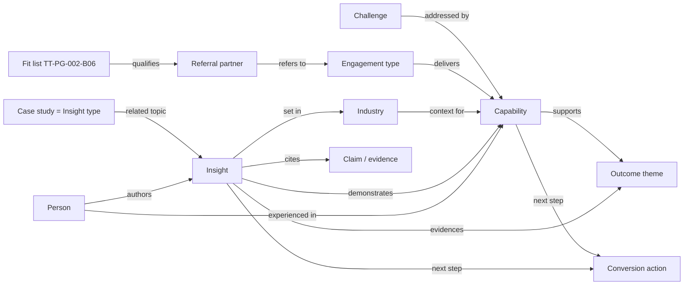

# 08 — Content Relationship Model

Purpose: connect existing content so a visitor can move from a problem, to the relevant capability, to proof, to a conversation, **without inventing links**. Every relationship below is justified by text in the source archive (block or article IDs cited). Where a relationship would be useful but no text supports it, it is listed as a gap, not a link.

---

## 1. Entities

| Entity | Count at launch | Source | Notes |
|---|---|---|---|
| Challenge | 9 | 6 problem cards (TT-PG-001-B03) + 3 "What we hear" cards (TT-INS-006-B03) | Existing wording; no new challenges |
| Engagement type | 4 | TT-PG-002-B04: Discovery · Execution Blueprint · Guided Implementation · Transformation Recovery | The client's path through the signature offer |
| Capability (component) | 6 | TT-PG-002-B05: Clarity & Discovery · Design & Alignment · Execution & Delivery · Transformation Recovery · Adoption & Outcomes · Ongoing Support | The "Expertise" entities |
| Outcome theme | 4 | Concept 06 (new, D-18): Better Decisions · Improved Performance · Efficient Operations · Sustainable Transformation | Taxonomy + homepage section only |
| Industry | 1 evidenced + selected experience | Healthcare (TT-INS-001/002/003/005/007/008/009/010); others single mentions | See §3.3 |
| Insight | 10 | TT-INS-001 … 010 | Content type per 09 schema |
| Person | 4 | TT-PG-004-B04 | |
| Claim / evidence | 17 | Claims register C-01 … C-17 ([12](12-gaps-and-decisions.md) §3) | Render only when verified |
| Conversion action | 5 | See [06](06-page-blueprints.md) / Contact | Intro call, message, discovery conversation, stalled-initiative conversation, referral enquiry |

## 2. Entity graph

## 3. Relationship tables

### 3.1 Challenge → Capability

| Challenge (exact title) | Source | Capability | Justification |
|---|---|---|---|
| Hidden misalignment | TT-PG-001-B03 | Clarity & Discovery; Design & Alignment | "Processes and teams pulling in different directions" ↔ "executive alignment", "process analysis" (TT-PG-002-B05) |
| Executing the wrong plan | TT-PG-001-B03 | Clarity & Discovery | "direction that hasn't been fully validated" ↔ "problem definition"; reinforced by TT-INS-006 |
| Stalled or failing implementations | TT-PG-001-B03 | Transformation Recovery | "Projects that lose momentum mid-execution" ↔ "Stalled project recovery" |
| High-stakes decisions under pressure | TT-PG-001-B03 | Clarity & Discovery; Design & Alignment | "ERP selections, vendor contracts" ↔ "system selection advisory", "decision frameworks" |
| Root causes masked as symptoms | TT-PG-001-B03 | Clarity & Discovery | "root cause analysis" named in the component |
| No clear ownership | TT-PG-001-B03 | Design & Alignment | "Ownership structures" (TT-PG-002-B04 Execution Blueprint); "governance model" |
| "We need to implement a new system" | TT-INS-006-B03 | Clarity & Discovery | "a process that is not understood end to end" |
| "Our current implementation isn't working" | TT-INS-006-B03 | Transformation Recovery; Clarity & Discovery | "executing without clarity on what the system needs to do" |
| "The team is not executing properly" | TT-INS-006-B03 | Design & Alignment | "the plan itself is wrong" |

### 3.2 Capability → Outcome theme

| Capability | Better Decisions | Improved Performance | Efficient Operations | Sustainable Transformation | Justification (TT-PG-002-B05 text) |
|---|---|---|---|---|---|
| Clarity & Discovery | ● | | ● | | problem definition, system selection advisory; process analysis, value stream mapping |
| Design & Alignment | ● | | | ● | decision frameworks, executive alignment; governance model |
| Execution & Delivery | | ● | ● | | implementation facilitation, execution management |
| Transformation Recovery | ● | ● | | | "measurable outcomes", vendor reset |
| Adoption & Outcomes | | ● | | ● | KPI definition, value realization, continuous improvement design |
| Ongoing Support | | | ● | | "efficiency tool optimization" |

### 3.3 Industry → Capability

Only Healthcare has enough evidence for a page (D-06). Other sectors are recorded as **selected experience** — they may be named on the Industries landing, never given pages or capability claims.

| Industry | Evidence | Capabilities shown in that evidence |
|---|---|---|
| **Healthcare** (compliance providers serving hospital systems; healthcare e-learning; PE-backed eye care network) | TT-INS-001-B08, 002, 003, 005, 007, 008, 009, 010; Mack Akhani bio ("PE-backed healthcare networks") | Transformation Recovery (002, 003, 007); Clarity & Discovery (005, 008); Execution & Delivery (009); Adoption & Outcomes (010) |
| Consumer technology platform (selected experience) | TT-INS-004 | Design & Alignment; Execution & Delivery |
| Global eCommerce, venture-funded technology start-ups (selected experience) | Mack Akhani bio only | none — biography only |
| CRM and SaaS platforms (selected experience) | Kranthi Kumar Goli bio only | none — biography only |

Supply chain / multi-location operations (TT-INS-009) is a **topic**, not an industry.

### 3.4 Insight → Capability / Industry / Outcome

| ID | Listing title | Capabilities | Industry | Outcome theme | Basis |
|---|---|---|---|---|---|
| TT-INS-001 | Mastering Kaizen Events | Clarity & Discovery; Adoption & Outcomes | Healthcare (example in B08) | Efficient Operations; Sustainable Transformation | Preparation/pilot; "Sustaining the Gains" (B09) |
| TT-INS-002 | Two Quarters of Migration Work, Cleared in a Single Day | Transformation Recovery; Execution & Delivery | Healthcare | Improved Performance | "65 client migrations actioned in a single day" |
| TT-INS-003 | A Seven-Year Migration, Closed in 19 Hours | Transformation Recovery; Execution & Delivery | Healthcare | Improved Performance | Seven-year initiative closed |
| TT-INS-004 | A Weekend Scrum-to-Kanban Migration Across Nine Teams | Design & Alignment; Execution & Delivery | Consumer technology (selected experience) | Efficient Operations | Delivery model redesign |
| TT-INS-005 | What Value Stream Mapping Found… | Clarity & Discovery; Adoption & Outcomes | Healthcare | Improved Performance; Efficient Operations | 209 → 78 days; "Capability transfer" tag |
| TT-INS-006 | You Don't Have an Execution Problem… | Clarity & Discovery | — | Better Decisions | Discovery-first, root cause |
| TT-INS-007 | The 19-Hour Project… | Transformation Recovery | Healthcare | Improved Performance | Stalled initiative |
| TT-INS-008 | When Processes Break Down, Look at the Handoffs… | Clarity & Discovery; Design & Alignment | Healthcare | Efficient Operations | VSM, handoff ownership |
| TT-INS-009 | Supply Chain at Scale… | Execution & Delivery; Clarity & Discovery | Healthcare (eye care) | Efficient Operations | Centralisation of purchasing |
| TT-INS-010 | Why Transformation Programs Fail After a Strong Start | Adoption & Outcomes | Healthcare | Sustainable Transformation | "gains are not consultant-dependent" |

### 3.5 Related-evidence pairs (cross-link by topic; never merge results)

**Company decision (2026-10-29):** articles describing similar engagements are treated as **separate engagements unless the company verifies they are the same organisation**. Pairs may cross-link as related reading because they share a topic. Results, client descriptions and attribution lines are **never** copied from one article to the other, and no page combines their figures. Verification is tracked as C-18 in [12](12-gaps-and-decisions.md).

| Pair | What the texts share | Engagement identity | Treatment |
|---|---|---|---|
| TT-INS-003 ↔ TT-INS-007 | 19-hour Kaizen execution, 7-year initiative, 389 hospitals, 10 migrations/quarter | **Treat as separate** (company decision): 003 says "healthcare compliance provider", 007 says "healthcare SaaS client" | Related-reading link only; each keeps its own client description and figures. E-06 withdrawn |
| TT-INS-005 ↔ TT-INS-010 | Healthcare e-learning platform; 209 → 78 days; 12% → 50% | Unverified (C-18) | Related-reading link only |
| TT-INS-002 ↔ TT-INS-008 | Medicare-related data loss at the intake handoff | Unverified (C-18) | Related-reading link only |
| TT-INS-001-B08 → TT-INS-002 | Kaizen example (65 migrations, 103 remaining) | Unverified (C-18); the figures match | Related-reading link from the example paragraph |

### 3.6 Person → Capability (from biographies only)

| Person | Capabilities | Basis (TT-PG-004-B04) |
|---|---|---|
| Mack Akhani | Transformation Recovery; Clarity & Discovery; Execution & Delivery | "closed a 7-year stalled initiative", "reduced implementation timelines", "centralized $89M in purchasing" — subject to C-02, C-10; author of all 10 insights |
| Hemang Dwivedi | Execution & Delivery; Design & Alignment | "full-stack enterprise systems", "visualizing complete end-to-end workflows" |
| Kranthi Kumar Goli | Execution & Delivery | QA architecture, "disciplined project delivery" |
| Devjet Bag | none | Internal finance role; no client capability link (D-07) |

### 3.7 Claim → Insight

Homepage statistics (TT-PG-001-B08) must link to the case study that substantiates them, and must not render unless the claim is verified (see 09, `Claim`).

| Claim | Substantiating insight |
|---|---|
| C-01 $3M+ | unresolved (D-05) — no link until resolved |
| C-04 90+ locations, C-06 $89M | TT-INS-009 |
| C-05 63% / 209 → 78 | TT-INS-005 |
| C-07 7 yrs / 2 years ahead | TT-INS-003 |

### 3.8 Referral partner → fit list → capabilities

Referral partners need "who should I send you?" The fit list (TT-PG-002-B06, canonical per D-14) already answers it. Path: Contact page referral paragraph (N-13) → fit list on `/services` → engagement types (Discovery for new decisions, Transformation Recovery for stalled initiatives) → Contact form with area of interest "Referral or partnership" (D-12). No partner page (12 §6).

## 4. Brief capability names as aliases (D-02)

The brief's five capability groups are **not pages**. They are stored as `aliases` on the existing capability entities so they can feed search metadata, internal search synonyms and Phase 2 wording, if approved.

| Brief name | Maps to existing capability | Evidence strength |
|---|---|---|
| Strategic Advisory | Design & Alignment + Clarity & Discovery | Moderate (component text) |
| Process Improvement | Clarity & Discovery | Strong (TT-INS-001, 005, 008) |
| Technology Transformation | Execution & Delivery | Moderate (ERP, integration, legacy migration) |
| Operational Excellence | Adoption & Outcomes | Moderate (TT-INS-010, continuous improvement) |
| AI & Digital Enablement | **none** | No evidence — D-03 |

## 5. Rules against artificial relationships

1. Every stored relationship carries a `basis` field citing a block or article ID. No basis, no link.
2. Related-content lists show **at most 3** items, chosen in this order: related-evidence pair (§3.5) → same capability → same industry → most recent.
3. An insight links to **at most 2** capabilities and **1** industry as primary tags; any further tags are for filtering only.
4. Person → capability links come from that person's approved biography only.
5. A claim renders only when `verification_status = verified`; its link goes to the substantiating insight.
6. "Selected experience" industries never generate pages, filters or "we serve" statements.
7. Relationships are reviewed whenever a source block is edited (provenance fields in [09](09-content-schema.md)).
