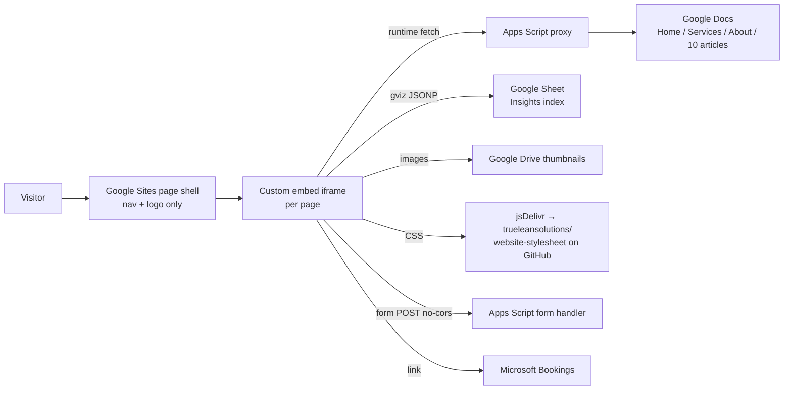

# 11 — Technical Architecture Recommendation

Scope: the technical *foundation* — how content, structure, integrations and (later) UI are separated, and which platform family to build on. Visual design and component design are Phase 2. Framework and vendor choices that depend on team skills or licences are left open and listed in §9.

---

## 1. Current-state architecture



| Finding (from [01](01-discovery-report.md) §5) | Architectural cause |
|---|---|
| T1 Content invisible to crawlers / fragile | Content rendered client-side inside an iframe from an external proxy |
| T2 `/` and `/home` duplicate | Google Sites routing; no canonical control |
| T3 No meta descriptions | Metadata lives inside the iframe, not the indexable page |
| T6 Articles have no URLs | Single listing page with modal; no routing |
| T8 Form reports success on failure | `no-cors` POST cannot read the response |
| T10 Styles depend on a True Lean Solutions repository | Shared CDN stylesheet |
| T11 No analytics | Not configured |
| T7 Apex domain fails | DNS, independent of platform |

What works and is worth keeping: authors are comfortable writing structured content in Google Docs using block markers (BANNER, CARDS, STEPS…); Microsoft Bookings for intro calls; a single shared content style across pages.

## 2. Requirements

| # | Requirement | Source |
|---|---|---|
| R1 | All content present in server-delivered HTML at its own URL | T1, T6, brief §14 |
| R2 | Full control of titles, descriptions, canonicals, redirects, sitemap.xml, robots.txt, structured data | [10](10-seo-url-plan.md) |
| R3 | Content stored separately from presentation, in the models of [09](09-content-schema.md), with provenance | Brief §12, §16 |
| R4 | Non-developers can update articles, people and settings without touching code | Brief §16 |
| R5 | Every change versioned, reviewable and reversible | Brief §16 |
| R6 | Preview of changes before publishing | — |
| R7 | Reliable form handling with real success/error states, spam protection, consent, routing | T8, T9, D-12 |
| R8 | Accessibility: WCAG 2.2 AA | Brief §16 |
| R9 | Fast delivery on mobile (budgets in §7) | Brief §16 |
| R10 | Analytics with consent handling, no personal data in events | D-16 |
| R11 | No runtime dependency on True Lean Solutions assets or third-party proxies | T10 |
| R12 | Low running cost and low maintenance for a small team | Business context |
| R13 | Room to grow (more insights, capabilities, industries, people) without restructuring | Brief Objective F |

## 3. Options compared

Ratings: ● strong · ◐ adequate · ○ weak. "Team skills" is provisional — the team has evidently used GitHub, jsDelivr, Apps Script, Google Docs/Sheets and Microsoft 365; developer skills have not been confirmed (D-15).

| Option | Maintain-ability | Running cost | SEO control | Performance | Content editing | Team-skills fit | Lock-in | Notes |
|---|---|---|---|---|---|---|---|---|
| 1. Stay on Google Sites (inline the content) | ○ | ● free | ○ no redirects, limited meta | ◐ | ● | ● | High | Cannot meet R2, R7; article URLs need one Sites page each |
| 2. Static site generator + content files in Git (e.g. Astro, Eleventy, Next.js static export) | ● | ● low | ● | ● | ○ for non-developers (Markdown/JSON in Git) | ◐ | Low — content is plain files | Meets R1–R3, R5, R9, R11 |
| 3. Option 2 + Git-based CMS editing UI (e.g. Decap, Tina) | ● | ● low | ● | ● | ◐–● form-based editing, commits to Git | ◐ | Low | Adds R4 and R6 on top of option 2 |
| 4. SSG + hosted headless CMS (e.g. Sanity, Contentful, Storyblok) | ◐ | ◐ free tiers → paid seats | ● | ● | ● | ○–◐ | Medium (content in vendor) | Strong editing; adds a vendor and schema migration |
| 5. SSG with build-time import from the existing Google Docs/Sheet | ◐ | ● | ● | ● | ● keeps today's habit | ● | Low–medium | Content is fetched **at build time**, not in the browser, so R1 is met. Parser must be maintained; Docs lack review workflow |
| 6. WordPress (managed) | ◐ plugins, updates | ◐ | ● with plugins | ◐ | ● | ◐ | Medium | Security/updates overhead disproportionate to ~25 pages |
| 7. Webflow / Framer | ◐ | ◐ subscription | ◐–● | ● | ● | ◐ | High | Visual-builder lock-in; structured relationships and provenance harder to enforce |

## 4. Recommendation

**Build a statically generated site whose content lives as structured files in version control (option 2), and choose the editing layer — a Git-based CMS (option 3) or a build-time Google Docs import (option 5) — once D-15 confirms who will edit the site.**

Why:
- It removes the root cause of T1, T2, T3, T6 and T10: every page and article becomes plain HTML at its own canonical URL, with metadata the site controls.
- The content models in [09](09-content-schema.md) map directly to typed content collections validated against the JSON Schemas in [`data/schema/`](data/schema/). Builds fail on invalid content — for example, an unverified claim on a stats block, or a relationship with no `basis`.
- Content stays portable (Markdown/JSON) and is not locked into a vendor. Moving to a headless CMS later (option 4) is a content import, not a rebuild.
- Running costs are low: static hosting plus one serverless function for the form.
- Option 5 is a genuine continuity path. The source Docs already use consistent block markers, the same structure the extraction for this audit relied on. If the team wants to keep writing in Google Docs, a build-time importer can convert Docs into validated content files. The trade-off is weaker review/approval control, so a pull-request review step should be kept.

**Framework:** Astro is a leading candidate (content collections with schema validation, zero JavaScript by default, static output, mature Markdown/MDX support). Eleventy and Next.js (static export) are reasonable alternatives. **Confirm against the implementing team's skills before committing** (D-15).

**Hosting:** a static host/CDN with preview deployments per change and a serverless function runtime (e.g. Cloudflare Pages, Netlify, Vercel, or Azure Static Web Apps if Microsoft 365 alignment matters). Choose during implementation planning.

**Forms:** a serverless function validates input, checks spam signals, creates a lead in **Zoho CRM**, sends an **email notification** to `info@techtranspire.com`, and returns a real success or error response (D-16, approved 2026-10-29, subject to technical feasibility; see §4a). The existing Microsoft Bookings link stays as it is.

### 4a. Contact form → Zoho CRM + email (approved direction)

```
Browser ──POST──► /api/contact (serverless)
                    1. validate fields (same rules as the client) + honeypot + min-submit-time + rate limit
                    2. Zoho CRM: POST https://www.zohoapis.{dc}/crm/v{n}/Leads   (OAuth access token from refresh token)
                    3. Email: notification to info@techtranspire.com (transactional email API or Zoho workflow)
                    4. respond { ok: true } only if step 2 OR step 3 succeeded
```

| Topic | Design |
|---|---|
| Authentication | Zoho OAuth 2.0 "self client". The refresh token, client ID and secret live in the host's encrypted environment variables and are never in the repository or the content. The access token is refreshed per request or cached in memory. Minimum scope: `ZohoCRM.modules.leads.CREATE`. |
| Data centre | `{dc}` must match the Zoho account (`com`, `eu`, `in`, `com.au`…). **Confirm before build.** |
| Field mapping | Name → `First_Name` / `Last_Name` (split on the last space; a single word goes to `Last_Name`) · Company → `Company` · Work email → `Email` · Phone → `Phone` · Message → `Description` · How did you hear → `Lead_Source` · Area of interest → custom picklist `Area_of_Interest` · Consent → custom `Privacy_Consent` + `Consent_Timestamp` · fixed `Lead_Source_Detail` = "Website contact form" + page URL. Custom fields must be created in Zoho first. |
| Duplicates | Use Zoho's `upsert` on Email (duplicate check field), so repeat enquiries attach to the same lead instead of creating duplicates. **Confirm the preferred behavior with the CRM owner.** |
| Email notification | Option 1: the function sends the email through a transactional provider (e.g. Postmark, Resend, Amazon SES, or the Microsoft Graph API with the existing Microsoft 365 tenant). Option 2: a Zoho CRM workflow rule ("on Lead create where Lead Source Detail = Website") sends the email. **Recommendation: Option 1.** Notification still works if Zoho is down, which is what makes the partial-failure rule below possible. |
| Partial failure | Zoho fails, email succeeds → visitor sees success; the email is flagged "NOT IN CRM — add manually". Email fails, Zoho succeeds → success; the error is logged and alerted. Both fail → visitor sees the failure state with direct contact details. |
| Fallback alternative | If API access isn't available on the Zoho plan, use Zoho **Web-to-Lead** posted server-side (keeping spam checks and real error handling), and send the email notification from the function. |
| Logging | Log the outcome only (success/failure, Zoho record ID, timing). **Never log message content or personal data.** |
| Testing | A Zoho sandbox, or a test lead source, in staging. Staging must never write to the production CRM without a "TEST" flag. |
| Feasibility checks before build | Zoho CRM edition supports API access; data centre; who can create custom fields; sender domain for notifications (SPF/DKIM/DMARC for `techtranspire.com`). |

**SEO caveat:** rebuilding does not by itself improve rankings. It makes the existing content crawlable, linkable and correctly described. Ranking outcomes depend on content quality, relevance and links, and should be measured after launch (Phase 5).

## 5. Logical separation (brief §16)

| Layer | Holds | Proposed location | Edited by |
|---|---|---|---|
| 1. Website content | Insights, capabilities, engagement types, challenges, industries, people, outcome themes, claims | `content/` (one folder per collection; Markdown or JSON per item) | Content editors |
| 2. Page definitions | Page records: slug, SEO, ordered block list referencing content | `content/pages/` | Content editors |
| 3. Navigation | Primary, footer and utility menus | `config/navigation.json` | Content editors (reviewed) |
| 4. Content relationships | `{ id, basis }` references inside content items; no separate link table | inside `content/` items | Content editors (reviewed) |
| 5. Assets | Images and files, with asset records | `content/assets/` (records) + `public/assets/` (files) | Content editors |
| 6. Business configuration | Contact details, booking URL, entity line, default SEO | `config/site-settings.json` | Owner only |
| 7. Technical integrations | Form handler, analytics, redirects, headers/CSP | `functions/`, `config/redirects.json`, `config/integrations.json` (no secrets) | Developers |
| 8. Future UI components | Templates and components (Phase 2/3) | `src/` | Developers |

Proposed repository structure (structure only; no UI):

```
techtranspire-website/
├── content/
│   ├── pages/            # Page records (09 §1)
│   ├── insights/         # TT-INS-### (09 §7)
│   ├── capabilities/     # CAP-## (09 §3)
│   ├── engagement-types/
│   ├── challenges/
│   ├── industries/
│   ├── people/
│   ├── outcome-themes/
│   ├── claims/           # C-## with verification status (09 §10)
│   └── assets/           # asset records (09 §12)
├── config/
│   ├── site-settings.json
│   ├── navigation.json
│   ├── redirects.json    # generated from 10-seo-url-plan.md
│   └── integrations.json # IDs only, no secrets
├── public/assets/        # image and file binaries
├── functions/            # serverless form handler
├── src/                  # templates/components — Phase 2/3
├── scripts/              # validation, Google Docs import (if option 5), link checking
├── docs/website-architecture/   # this Phase 1 documentation and source archive
└── .github/workflows/    # build, validate, deploy
```

## 6. Environments, version control, deployment

| Topic | Approach |
|---|---|
| Version control | Git repository (GitHub is already in use); `main` is production; every change through a pull request |
| Environments | **Preview** per pull request · **Staging** (protected, `noindex`) · **Production** `https://www.techtranspire.com` |
| Build checks (CI) | JSON Schema validation of all content; claims gate (`verification_status = verified`); internal link check; redirect table check (no chains or loops); accessibility lint; HTML validation |
| Deployment | Automatic on merge to `main`; instant rollback to a previous deploy |
| Domain | Fix apex → `www` redirect (D-19); HTTPS only; HSTS after launch is stable |
| Staging protection | `X-Robots-Tag: noindex` and password or access control |

## 7. Quality, security and operations

| Area | Requirement |
|---|---|
| Accessibility | WCAG 2.2 AA target; semantic headings follow [10](10-seo-url-plan.md) heading rules; alt text required on non-decorative assets (build fails otherwise); keyboard-operable forms; error messages linked to fields |
| Performance budgets (mobile, 75th percentile) | LCP ≤ 2.5 s · INP ≤ 200 ms · CLS ≤ 0.1 · JavaScript per page ≤ 100 KB compressed unless justified · images responsive and modern formats |
| Form security | Server-side validation; honeypot + rate limiting, plus a privacy-respecting challenge if spam appears; length limits; no secrets in client code; secrets in host environment variables |
| Headers | Content-Security-Policy allow-list (self + chosen analytics + Bookings link), `Referrer-Policy`, `X-Content-Type-Options`, `Permissions-Policy` |
| Privacy | Consent text and privacy policy link on the form (D-12, D-13); data minimisation; retention period defined in the privacy policy |
| Analytics | Choose between a privacy-friendly, cookieless tool (no consent banner normally needed for basic use, depending on jurisdiction) and GA4 (needs consent handling where required). Events defined in [06](06-page-blueprints.md) / [09](09-content-schema.md) §15; never send personal data. Decision D-16 |
| Error handling | Custom 404 with links to Expertise, Insights and Contact; form error state with the email address as a fallback; build fails on broken internal links |
| Monitoring | Uptime check on home and the form function; form-delivery alert if the function errors; Search Console coverage and Core Web Vitals reports; monthly broken-link check |
| Backups | Git history is the content backup; source archive retained in `docs/website-architecture/source-archive/` |

## 8. Migration of the current content pipeline

1. Convert the archived source (already captured verbatim, [`data/content-blocks.json`](data/content-blocks.json)) into content files under the 09 models. This can be scripted: the block markers map one-to-one to block types.
2. Copy the archived images (`source-archive/assets/`) into `public/assets/`; obtain the logo master (MS-03).
3. Rebuild the contact form on the new handler; keep the Microsoft Bookings link.
4. Remove all runtime dependencies on the Apps Script proxies, the Google Sheet, Drive thumbnails and the True Lean Solutions stylesheet.
5. Keep the Google Docs as read-only historical sources until launch sign-off, then archive them.

## 9. Decisions left open

| Decision | When | Depends on |
|---|---|---|
| Editing layer: Git-based CMS vs Google Docs import vs headless CMS | Before Phase 3 | D-15: who edits, how often, review needs |
| Framework (Astro / Eleventy / Next.js static) | Implementation planning | Team skills |
| Hosting provider | Implementation planning | Cost, Microsoft alignment, team familiarity |
| ~~CRM and form destination~~ | **Decided:** Zoho CRM + email notification (D-16). Open sub-items: Zoho data centre, API access on current plan, email-sending method | Before Contact build |
| Analytics tool and consent approach | Before launch | D-16, legal advice on applicable privacy law |
| Search on site | P2 | Insight volume; with ≤ 25 items, listing filters are enough at launch |
| Image pipeline and formats | Phase 2/3 | Design system |
| Component library / CSS approach | Phase 2 | Design system — not decided here |
